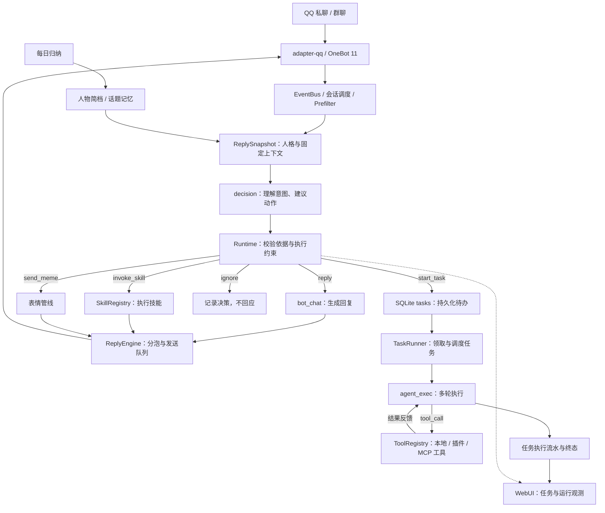

# 攸宁 · Youning

[](https://github.com/haotemans/youning/actions/workflows/ci.yml)

> 从一句回应开始，成为日常里可靠的帮手。

**攸宁（Youning）** 是一个以 Rust 构建的可扩展个人智能助手。它从 QQ 私聊与群聊出发，将对话、记忆、参与判断与工具调用连接起来：在需要时回应，在有事时帮忙，也知道什么时候保持安静。

聊天是入口，而不是边界。攸宁希望逐步走向桌面端与更多平台，让信息整理和日常任务也能自然地融入对话。

项目原名 **云团bot（yuantuanbot）**。「攸宁」是项目名，不要求每个使用者都把自己的助手叫作「云团」；你可以在管理面板中编辑人格，塑造属于自己的交流方式。

> **更名与兼容性**：仓库与项目展示名称已改为 `youning` / 攸宁。当前 Cargo 包、可执行文件、发布产物及默认数据库仍沿用 `yuantuan` 命名，下面的运行命令与文件路径因此保留原名。此次 README 更新不涉及代码重命名或数据迁移，请勿直接把这些路径替换为 `youning`。

## 现在能做什么

| 能力 | 说明 |
| --- | --- |
| 私聊与群聊 | 通过 NapCat / OneBot 11 接入 QQ，处理私聊、群聊、@、引用和图片消息。 |
| 对话与记忆 | 可编辑人格，结合人物简档、话题记忆、近期对话与每日归纳组织回复。 |
| 有分寸地参与 | 通过预过滤、Decision 参与判断与节流机制，决定回应、调用能力或保持安静，而不是对每条消息机械作答。 |
| 工具与任务 | 提供 Agent 任务执行、插件与 MCP 接入；仓库包含搜索、社交媒体解析、生图和群管理插件。Docker 开发沙箱可选启用，默认关闭。 |
| Web 管理面板 | 在浏览器中管理模型、配置、任务、记忆及运行状态，查看决策与事件记录。 |
| 轻量自托管 | Rust 后端、内嵌前端与 SQLite 本地存储，以单二进制部署为基础；实际资源占用取决于配置、负载和启用的外部服务。 |

具体工具能力取决于插件开关、模型与外部服务配置。设计目标不等于当前实现已全部完成；实现边界与已知差距见[信息流实现参考](docs/reference/message-flow-rules.md)。

**技术栈**：Rust + Axum + Tokio + SQLx + SQLite；Vue 3 + Vite + TypeScript + Naive UI。

## Agent 架构

攸宁当前采用 **自研 Rust 运行时 + 事件驱动 + 三角色模型分工 + 对话／任务双路径**。模型负责理解意图、生成内容和选择下一步；宿主代码负责上下文、动作校验、能力调用、执行预算与状态落库，而不是让一个模型直接包办整个系统。

这里的「三角色」是同一运行时中的三种模型职责，可以分别绑定 provider 和 model，并不要求使用三个不同模型，也不是三个互相聊天的独立 Agent。对话路径面向即时交流与技能调用，任务路径面向需要多轮工具执行的工作。

### 整体链路



图中是常规语义处理路径。命中的插件命令或消息匹配器可以走确定性直派，不必先经过 Decision；Skill 的渲染结果与附件直接进入回复队列，不要求再经过一次 `bot_chat` 包装。核心与 QQ 协议解耦，发送能力由装配层注入，当前实际接入仍以 QQ 为主。

### 三种模型角色

| 角色 | 负责什么 | 输出交给谁 |
| --- | --- | --- |
| `decision` | 判断发言对象、意图、对话承接及是否值得参与；建议回复、忽略、发图、调用技能或创建任务。 | 输出结构化 JSON，由 Runtime 校验、约束，再交给 Bot 管线分发；不是直接面向用户写答案。 |
| `bot_chat` | 根据人格、同一份回复快照和回复方式生成自然语言内容。 | 交给 `ReplyEngine` 做分泡、延时与会话发送排队。 |
| `agent_exec` | 围绕任务目标，选择工具、读取执行结果，并决定继续或结束。 | 输出 `tool_call / reply / done`，由 `TaskRunner` 执行并记录。 |

三者通过 [LlmGateway](crates/core/src/llm.rs) 使用统一的模型调用入口，角色绑定保存在 `providers.toml`。角色是职责分工，不与某个模型品牌绑定；例如每日归纳也复用 `decision` 角色。当前 Agent 执行采用应用层 JSON 动作协议，由 Rust 查表调用工具，不依赖模型直接执行代码。

### 对话管线：先判断，再回应

[Bot 管线](crates/core/src/bot.rs) 将普通消息按固定窗口聚合，按会话调度；同一会话串行处理，不同会话可并发。`Prefilter` 先处理硬过滤与节流，再进入上下文读取和模型决策。

[Decision](crates/core/src/decision.rs) 给出动作建议后，宿主继续检查请求原话、当前会话可用的技能、可见消息依据、对话对象和参与冷却。模型的建议不等于最终执行指令；不满足约束时可以收紧为澄清、说明不确定或忽略。输出格式不合法时重试一次，再失败则保守忽略，并保留 Trace。详细规则见[语义参与决策框架](docs/reference/decision-framework.md)。

普通回答、技能结果和表情最终汇入回复引擎。**日常聊天不需要每次启动一个多轮 Agent 任务**，明确需要工具循环的请求才进入 `start_task` 路径。

### 上下文与记忆：固定快照，保留出处

[Context Builder](crates/core/src/context_builder.rs) 在一次数据库读事务中构建 `ReplySnapshot`，包含回复锚点、引用原文、近期消息、人物简档、话题记忆、人格、对话承接与活动任务状态。Decision 与普通聊天回复共享这份快照，避免模型等待期间的新消息改变本轮事实范围或回复对象。

[记忆层](crates/core/src/memory.rs) 区分人物简档、话题记忆与每日摘要：简档记录有本人原话依据的相对稳定信息，话题记忆按当前问题检索，每日摘要用于梳理历史。当前检索基于词项匹配，并非向量检索；资料保留来源与时间，来源可定位也不等于语义已经验证。上下文预算目前以字符数近似控制，不是精确 token 预算。

[每日归纳](crates/core/src/consolidation.rs) 作为后台侧路整理摘要、记忆与关系信息，影响后续回复，不改写已生成的本轮快照，也不自动训练模型或修改人格。活动任务的 `running` 状态只证明调度状态，不能作为「已经执行成功」的证据。

### 能力扩展：Tool、Skill、Plugin 与 MCP

| 扩展层 | 当前实现与职责 |
| --- | --- |
| **Tool** | 最小执行能力，提供名称、描述、参数 schema 和调用接口；由 [ToolRegistry](crates/core/src/tools.rs) 统一注册。Agent 从注册表获取工具目录并执行。 |
| **Skill** | 可复用的技能入口，可封装提示词模板、模型调用或工具逻辑；由 [SkillRegistry](crates/core/src/skills.rs) 管理，支持 Decision 选择及命令／消息匹配直派。当前是 Rust trait 实现，不是运行时加载 `SKILL.md`。 |
| **Plugin** | 打包与管理 Tool、Skill 的工程单元，通过 `plugin-api` 接入宿主。当前是编译进程序的 Rust 插件，运行时可启停和调整配置；宿主约束会话范围、超时、并发与输出大小，见[插件宿主](crates/core/src/plugins.rs)。 |
| **MCP** | 通过本地子进程的 stdio 连接外部服务，将发现的工具包装后接入同一 ToolRegistry；当前实现覆盖工具发现与调用所需的子集，见 [MCP 客户端](crates/core/src/mcp.rs)。 |

Docker 开发沙箱是可选工具能力，默认关闭，配置见[开发沙箱指南](docs/reference/agent-sandbox.md)。它不意味着所有原生插件和 MCP 子进程都自动运行在沙箱中；这些扩展仍应按受信任代码配置和使用。

### 任务执行：有预算、有记录、不盲目重放

[Agent 执行器](crates/core/src/agent.rs) 的闭环是：

```text
任务目标 + 工具目录 + 本任务执行历史
  → agent_exec 输出下一步 JSON
  → tool_call：调用已注册工具，将结果或错误反馈到下一轮
  → reply：记录中间文本，继续执行（不是向聊天窗口发消息）
  → done：保存最终结果；失败或预算耗尽则记录失败终态
```

`create_task` 先将任务持久化到 SQLite，再发布 `TaskCreated` 唤醒执行器。**数据库是任务待办的权威来源，事件只是唤醒信号**；Runner 也会定期扫描数据库，因此不依赖每一条通知都被及时消费。

当前限制为 **最多 3 个并发任务、每任务最多 10 轮模型调用、单次工具调用最多等待 120 秒**。连续 2 次 JSON 解析失败或连续 3 次工具调用抛错会结束任务；模型调用失败、工具超时和 worker panic 也进入失败处理。插件或工具自身还可能有更严格的限制。

任务状态与结束记录在同一事务中提交后，才广播完成事件；收尾落库失败会保留结果重试，不为补写状态而重新执行工具。重启后，尚未开始的任务可以继续被领取；已开始但中断的任务会标记失败，**不会自动重放可能产生重复副作用的工具调用**。这不是任意步骤断点续跑或副作用恰好一次保证。

当前任务上下文主要是目标与该任务的执行历史，尚未直接复用完整聊天回复快照；任务中间文本和最终结果保存在 `tasks / task_events` 并供 WebUI 查看，**尚未形成 Agent 完成结果自动回传聊天的完整链路**。

### 运行支撑与源码入口

主进程在 [main.rs](crates/yuantuan/src/main.rs) 中装配对话管线、任务执行器、插件、MCP、每日归纳和 WebUI。SQLite 保存业务状态与任务流水；[EventBus](crates/core/src/event.rs) 使用进程内 `tokio::broadcast` 解耦模块，Tracer 与面板用于观测。事件总线不是持久消息队列，观测事件可能因消费滞后而丢失，不能用 Trace 代替任务数据库判断是否完成。

本节依据 `e8ddbd0` 的相关代码与实现参考整理，属于架构概览和静态代码核对，不代表重新完成了真实 QQ、模型与工具的端到端验收。设计细节与未决事项继续以 [docs/README.md](docs/README.md) 中的实现参考和工作记录为入口。

## 接下来想走的方向

以下是演进方向，不代表当前版本已经完整支持。

| 方向 | 希望带来的体验 |
| --- | --- |
| 桌面端 | 不依赖聊天平台，也能在桌面上使用和管理自己的助手。 |
| 更多平台适配器 | 让同一套对话、记忆与工具能力连接更多消息入口和服务。 |
| 评论区分析 | 在获得授权的范围内整理评论、归纳话题，辅助理解受众特征与反馈。 |
| 邮箱整理 | 帮助分类邮件、提取摘要和待办，把分散的信息变成可处理的事情。 |

## 快速开始

### 准备条件

QQ 接入需要一个已能正常登录的 NapCat 实例；对话与任务执行需要配置可用的 LLM provider。当前 QQ 接入采用 **OneBot 11 反向 WebSocket**：攸宁监听，NapCat 主动连接。

从源码构建还需要 **Rust stable** 与 **Node.js 24 + npm**，与仓库 CI 的工具链选择保持一致。Node.js 仅用于前端构建。

### 方式一：下载二进制

不想本地编译，可以到 [Releases](https://github.com/haotemans/youning/releases) 查看发布包。CI 会在 `v*` tag 构建成功后发布；普通分支提交的构建产物可在 [Actions](https://github.com/haotemans/youning/actions/workflows/ci.yml) 对应运行的 Artifacts 中获取。

| 平台 | 发布产物 |
| --- | --- |
| Linux x86_64 | `yuantuan-linux-x86_64`，musl 构建，附同名 `.sha256` 校验和文件。 |
| Windows x86_64 | `yuantuan-windows-x86_64.zip`，解压后运行 `yuantuan.exe`。 |

Linux：

```bash
chmod +x yuantuan-linux-x86_64
./yuantuan-linux-x86_64
```

Windows PowerShell（在解压目录中）：

```powershell
.\yuantuan.exe
```

前端已嵌入发布二进制。配置文件缺失时，首次运行会生成 `config.toml` / `providers.toml` 模板；生成模板不等于已经完成模型和 QQ 接入配置，请继续下面的配置步骤。

### 方式二：从源码构建

```bash
git clone https://github.com/haotemans/youning.git
cd youning

# 构建前端，产物将嵌入 Rust 二进制
cd webui-frontend
npm ci
npm run build
cd ..

# 启动后端；当前 Cargo 包名仍为 yuantuan
cargo run --locked -p yuantuan
```

前端产物写入 `crates/webui/static/` 并随仓库保留，因此也可以使用已有产物直接构建后端；修改前端后需要重新构建前端，再构建 Rust 二进制。缺少完整前端产物时，内嵌的 `static/legacy-index.html` 仅作为占位兜底。

### 完成配置与 QQ 连接

配置和数据文件以运行时的工作目录为基准。首次准备配置时，先停止攸宁，检查以下内容，再重新启动：

| 文件 | 用途与注意事项 |
| --- | --- |
| `config.toml` | 主配置，包括 NapCat 监听地址与 Token、WebUI 端口、数据目录、参与节流、每日归纳及表情设置。请按自己的环境设置 `[security].super_admin_qq`，不要沿用仓库中的管理员 QQ。 |
| `providers.toml` | LLM providers 与角色绑定。密钥可通过 `api_key_env` 引用环境变量；不要把真实 API 密钥提交到仓库。 |
| `data/` | 默认运行数据目录，包含 `yuantuan.db`、表情、任务产物与日志等；可通过 `[data].dir` 调整。 |

从源码运行时，仓库中已有的配置同样需要检查。请为 `[napcat].token` 设置自己的随机 Token，不要沿用示例值。

1. **启动攸宁**，确认正在监听配置中的反向 WebSocket 地址，默认是 `ws://127.0.0.1:6199/ws`。
2. **在 NapCat WebUI 中添加连接**：进入「网络配置」，新建 **Websockets 客户端**，名称可填「攸宁」，URL 填 `ws://127.0.0.1:6199/ws`，Token 与 `config.toml` 中 `[napcat].token` 保持一致，启用并保存。
3. **打开管理面板**：访问 `http://127.0.0.1:8085/`，首次登录时设置管理员密码，再到「配置 / 模型」页配置 providers，并绑定 `decision`、`bot_chat`、`agent_exec` 角色。
4. **检查连接与模型状态**：日志出现 `NapCat WS 已连接` 和 `get_login_info 完成 self_qq=...` 表示 QQ 链路已建立；模型角色尚未配置时，不能据此认为助手已经可以正常回复。

上述 `127.0.0.1` 地址适用于两个进程处于同一主机网络环境的情况。NapCat 位于容器或另一台机器时，需要改为它实际可访问的地址，并同步检查攸宁的监听地址与防火墙；部署配置可参考 [deploy/compose.yml](deploy/compose.yml)。

## 地址与端口速查

| 用途 | 地址 / 端口 | 说明 |
| --- | --- | --- |
| 管理面板 | `http://127.0.0.1:8085/` | 攸宁提供，首次登录设置管理员密码。 |
| 后端 API 与事件推送 | `http://127.0.0.1:8085/api/*`、`ws://127.0.0.1:8085/ws` | 与管理面板同源。 |
| NapCat 反向 WebSocket | `ws://127.0.0.1:6199/ws` | 攸宁监听，NapCat 的 Websockets 客户端主动连接。 |
| NapCat WebUI | `http://127.0.0.1:6099/webui` | NapCat 自身的管理面板，以实际部署配置为准。 |
| 前端开发服务 | `http://127.0.0.1:5173/` | 在 `webui-frontend/` 中执行 `npm run dev`，仅用于前端开发。 |

管理面板和 OneBot 接口不要直接暴露到公网。需要远程访问时，使用受控网络或带 TLS 与访问控制的反向代理，并在开放访问前完成管理员密码和 Token 配置。插件、MCP 与开发沙箱可能访问外部服务或执行操作，仅启用你信任且确有需要的能力。

更新攸宁服务时应保留现有数据库、配置、插件状态和 NapCat 登录数据；不要为了更新攸宁而顺带重建或重启 NapCat。

### 忘记管理员密码

先停止攸宁，备份实际数据目录，再仅清除管理员密码哈希：

```bash
sqlite3 data/yuantuan.db "DELETE FROM state_kv WHERE key='admin_pass_hash';"
```

上述路径适用于默认数据目录；修改过 `[data].dir` 时请使用对应路径。重启后，在本机重新设置管理员密码。此操作不删除聊天与任务数据，**不要通过删除整个 `data/` 目录来重置密码**。

## 工程结构

```text
crates/
  core/          对话、Agent、参与判断、记忆、工具、归纳、表情与数据库等领域逻辑
  adapter-qq/    NapCat / OneBot 11 适配，反向 WebSocket 接入与消息收发
  plugin-api/    插件接口与共享契约
  webui/         Axum API、WebSocket 事件推送与内嵌前端
  yuantuan/      配置加载、系统装配与程序入口（保留现有包名）
plugins/         搜索、社交媒体解析、生图与群管理等插件
webui-frontend/  Vue 3 + Vite + Naive UI 管理面板
                  构建产物写入 crates/webui/static/
deploy/          部署脚本与容器配置
data/            运行时生成：yuantuan.db、memes/、artifacts/、logs/ 等
docs/            设计、实现参考、工作记录、决策与历史归档
```

## 文档

完整入口见 [docs/README.md](docs/README.md)。设计文档描述目标，实现参考描述代码行为与已知差距，历史记录中的验收结论只对应当时的版本。部分文档、界面与日志仍保留旧名称，不代表需要另装一个项目。

| 想了解什么 | 入口 |
| --- | --- |
| 架构与运行机制 | [总体架构](docs/design/architecture-v0.1.md)、[运行时设计](docs/design/runtime-design.md) |
| 消息处理与参与判断 | [信息流实现参考](docs/reference/message-flow-rules.md)、[语义参与决策框架](docs/reference/decision-framework.md) |
| 人格、人物资料与记忆如何进入回复 | [Bot 上下文](docs/reference/bot-context.md)、[上下文术语](CONTEXT.md) |
| Agent 如何使用 Git、Python 与 Bun | [开发沙箱指南](docs/reference/agent-sandbox.md)，包含配置与 Linux 部署说明 |
| SQLite、迁移、连接池与事务 | [异步数据库访问](docs/reference/sqlite-access.md)、[数据模型](docs/reference/data-model.md)；实际迁移以代码为准 |
| 当前工作与历史取舍 | [活跃工作](docs/changes/README.md)、[ADR](docs/adr/README.md)、[历史归档](docs/archive/README.md) |
| 如何维护与贡献 | [开发治理协议](docs/governance.md) |

## 开发与测试

运行 Rust workspace 测试：

```bash
cargo test --locked --workspace
```

前端类型检查与构建：

```bash
cd webui-frontend
npm ci
npm run build
```

CI 还包含表情库与关系图谱的浏览器测试，具体入口见 [CI 工作流](.github/workflows/ci.yml)。构建或自动化测试通过不等于已经验证真实 QQ、模型服务与所有插件配置，部署后仍需检查自己的运行环境。

## 修订记录

- 2026-10-26：新增 Agent 架构概览、流程图与源码入口，说明三角色分工、对话与任务双路径、上下文和记忆、扩展机制、任务执行限制及当前实现边界。
- 2026-10-26：项目首页更名为「攸宁 · Youning」，明确个人智能助手定位，区分当前能力与未来方向；更新仓库链接与安装说明，保留兼容现有程序和数据的名称。
