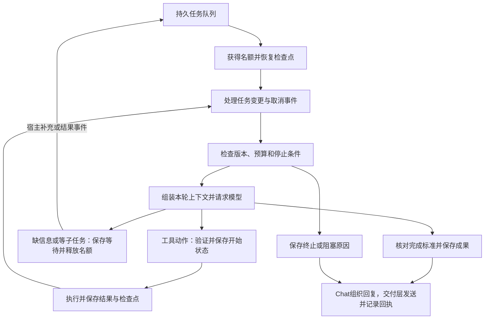

# ADR-0018：Docker 部署的轻量通用 Agent、工作记忆与任务交接

日期：2026-11-13。状态：accepted（目标设计；尚未实现、迁移或部署）。

[ADR 索引](README.md) · [文档入口](../README.md) · [现有任务功能](../features/core/tasks.md) · [现有记忆功能](../features/core/memory.md)

## 1. 决策与边界

保留 Router（现代码 decision）、Chat（bot_chat）、Agent（agent_exec）三种模型职责。Chat 对接用户，Router 分配上下文、记忆、任务范围与预算，Agent 负责任务细节、工具选择和执行。Runtime 是宿主程序，不是第四个模型角色。

Agent 只接收任务事件，不直接订阅群聊、询问群友或向 QQ 发送文字/文件。缺信息、需要登录、进度、成果和失败由 Agent 返回宿主，经 Chat 对接用户；交付层执行发送并保存回执。Agent 处理任务相关的网页、文件及授权外部操作不因这个交互边界而被取消。

Docker 是部署基准。浏览器、接收和生成文件、实际发送文件均为目标能力；安装容器或注册工具名称不等于执行能力已验收。浏览器服务、文件桥接和模型协议适配都需要真实闭环验证。

本决定细化 ADR-0012 的交接、工作记忆、模型适配与 Docker 工具目标，保留既有来源隔离、默认两个任务执行槽、根预算共享、未知外部动作不重放和持久交付约束。夜间人物整理继续采用已确认的凌晨3点、每晚最多10人、间隔60秒串行规则，不承担当前任务的即时记忆。

## 2. 当前实现与缺口

核对基线为 main `66eafefb14f9a70ac0e3b5483575a9452b0e9629`，仅是源码核对。

| 已有实现 | 尚不能据此宣称完成的目标 |
| --- | --- |
| SQLite 中有原始消息、记忆、任务检查点、调用回执和 outbox | 聊天中尚未启动 Agent 的目标、条件、指代和决定没有完整统一的工作记忆契约 |
| Chat 可以提出 execution_request，经 Decision 派工 | 交接主要依赖目标及截取的上下文，尚非本文完整任务说明和变更协议 |
| Agent 有 JSON 动作循环、子任务、预算、恢复及结果回聊 | 尚未统一本文的模型能力协商、浏览器会话和通用文件成果协议 |
| 插件/Tool/MCP 注册及部分媒体投递已存在 | 工具已登记不证明每种模型和 Docker 配置下可实际执行 |
| 可选 Docker 沙箱及任务工作卷 | 普通主镜像没有自动具备浏览器、Python 或全部 MCP 子进程依赖 |
| NapCat 共享部分生图/下载成果目录 | 通用任务生成的文档、表格和其他文件还需要统一交付路径 |

实际实现、配置和测试归属继续以对应[功能主文档](../features/README.md)为准；本 ADR 不替代功能主文档，也不新增实际数据库表、API 或工具。

参考本地 Codex 源码快照 `553c764e8b` 的 `session/turn.rs`、`tools/parallel.rs`、`context_manager/history.rs` 与 agent 生命周期机制。借鉴执行循环、步骤归属、取消、输入队列和上下文投影；不复制产品专用交互、特定模型提示、服务商私有压缩协议或整套平台。引用使用版本与仓库相对路径，不要求其他开发者拥有相同机器目录。

## 3. 数据事实与上下文投影

SQLite 保存可追溯事实和状态，文件存储保存原始附件与产物；模型接收本轮需要的投影。三角色共享同一任务的目标、要求、进度和结果版本，但不机械复制全部提示。

- Chat 投影：当前作者与会话、锚点、引用、近期连续对话、相关人物/群聊简档、当前讨论及关联任务状态。
- Router 投影：输入归属、正在讨论/执行的事项、待答问题、相关记忆候选、能力可用性、预算与任务变更。
- Agent 投影：任务说明、必要背景、材料引用、检查点、实际调用回执和最新有效变更。

来源均保留消息/会话类型/作者/时间/版本；明确区分用户要求、历史资料、模型推断与工具事实。跨群人物可以统一认识，但私聊材料不得自动进入群聊投影。网页、文件和工具输出不成为新的用户授权。

默认最近连续对话加近30天相关历史原文；30天是检索范围，不是全量提示。300k 是上下文上限，实际还受所用模型能力和输出预留限制。模型窗口上限与根任务累计消耗是不同额度，分别记录。

稳定角色规则、已授权工具定义及稳定资料保持可复用前缀；动态事件追加。缓存键至少包含模型/协议、角色规则版本、工具目录版本、任务版本和来源可见范围；发生要求变更时不沿用旧任务状态。缓存是优化，不能成为恢复所必需的唯一状态。

压缩保留目标、限制、已确认决定、进度、关键证据、成果引用和未决问题；原文及完整回执仍可读取。压缩前后保留范围和版本，不把摘要当作独立事实；压缩本身不算任务进展。

## 4. 四类记忆与写入责任

| 类别 | 内容 | 更新时机 |
| --- | --- | --- |
| 会话工作记忆 | 当前话题、指代、已确认条件、待答问题、关联任务；未启动 Agent 的设计讨论也有此状态 | 对话发生语义变化时即时更新 |
| 任务过程记忆 | 目标、约束、已完成/未完成、工具结果、材料、成果版本、错误和下一步 | 每次任务变化和实际执行后 |
| 长期人物与群聊记忆 | 一人一份简短综合画像及有依据的条目；群的背景、梗、话题/事件进展和每日概览 | Router 决定归属、价值与有效期，夜间进一步归纳 |
| 任务归档记忆 | 最终交付、有效方法、失败原因、可复用成果和后续事项 | 任务完成、失败、取消或归档时整理 |

Chat 提交交谈中的要求、确认和纠正候选；Agent 提交执行结果和经验候选。Router 决定语义条目保留什么、归属人物/群聊/讨论/任务、替代哪个旧条件，以及何时失效；Runtime 实际执行校验、事务和落库。不得让模型任意运行 SQL。

原始消息、状态变迁、工具回执、检查点和发送回执由程序即时保存，不等待 Router 再调用模型判断是否值得保留。一次工具结果落库不要求额外走一次 Router 模型。临时推测和 Bot 旧回答不能直接升级为长期事实。

讨论和任务均有稳定编号，建立消息与事项的关联。一个群可并行讨论多件事，同一个人可有多个任务；Router 结合请求者、引用、讨论对象及活动事项选择新建/补充/修改/询问进度/闲聊/停止。指代有歧义时由 Chat 澄清，不默认绑到整个群的最后一个任务。

示例：先讨论 A/B 模型，再补充4090、本地部署和表格交付，必须更新同一事项的约束，并在后续投影中保留；不能只传最后一句“发张表”，也不能把这些临时要求都塞进人物画像。

## 5. Chat 到 Agent 的任务说明

Router 根据 Chat 理解的需求和真实来源形成版本化任务说明，逻辑字段如下（不是现有 API/DDL）：

| 字段组 | 必需内容 |
| --- | --- |
| 归属 | task/root/parent 标识、请求者、会话类型及编号、关联讨论、原消息引用 |
| 目标与交付 | 具体目标、期望格式、完成标准、交付对象 |
| 已确认要求 | 条件、限制、已解析指代、用户决定、每项来源及时间 |
| 材料 | 文件/网页/图片观察/记忆的引用与可见范围；必要背景及尚未解决的问题 |
| 执行边界 | 授权能力和资源范围、调用/时间/上下文预算、可用子任务额度 |
| 执行状态 | 当前版本、步骤、有效结果、检查点、下一步、阻塞和待处理变更 |

Agent 在范围内自行拆步骤、选关键词、选择工具与调整方法；Router 不替它安排每次点击。改变目标、扩大范围或缺少授权时再交回 Router。首个交接仍经过 Router，任务范围内后续工具步骤不重复走完整 Router→Chat 分类链。

补充要求通过任务事件进入，保留原文和归属；更新版本后，下轮执行读取有效版本。迟到结果保存为真实发生的回执，但旧版本成果不能冒充新要求的完成结果。暂停/取消已开始的外部动作，不保证能撤销已经发生的效果。

## 6. 工具与模型适配契约

内部工具目录在 SQLite 保存定义、配置、启用范围和调用记录；Runtime 执行器注册表表示进程实际可用的能力。模型可见目录是两者按调用者、任务授权、会话和健康状态的交集。工具定义变化更新目录版本，不凭名字宣称可用。

每个定义需声明：名称、描述、输入/输出 Schema、执行主体、作用范围、外部影响、资源锁、可并行性、超时、取消行为、错误分类、重试条件和幂等/核实方式。技能是组织多个工具的方法或流程，不是绕过相同执行规则的第二套入口。

每次调用包含调用编号、任务与版本、工具、参数、材料引用及预算。Runtime 校验后先保存开始状态，再执行。回执保留成功/失败/超时/取消/等待/不确定状态、错误分类、是否可重试、耗时、来源、产物与完整结果引用。输出摘要只是投影，不取代原始结果。

模型适配器将原生 tool_call 或受验证的结构化 JSON 转成统一内部动作；不支持某种协议或模态时明确报告能力差距。保留 tool_call 与 tool_result 的编号对应，不把全部角色和工具记录压平成无类型文本。文字、执行需求、等待和完成均有明确事件类型。非法输出有限修复，拒绝和截断不作为成功结果；不因兼容返回格式而执行模型自造的任意工具。

模型能力声明至少覆盖：输入模态、实际上下文上限、工具协议、结构化输出、流式和并行调用、缓存以及用量统计能力。推理强度或服务商压缩等可选能力留在适配器，不成为任务循环运行的前提。换模型后凭显式任务状态和回执续跑，不依赖上一模型未保存的内部思考。

Agent 工具优先涵盖搜索、网页阅读、浏览器操作、文件读取/生成、计算与代码执行、子任务调度。记忆归属和任务目标变更由 Router 管理；Agent 按分配范围读取材料，新增记忆作为候选提交。QQ 用户消息/文件交付由 Chat 与交付层执行，不向 Agent 暴露绕过该边界的任意发送入口。

## 7. Agent loop 与调度

任务状态为排队、执行、等待输入、等待子任务、等待外部事件、暂停、完成、失败、取消。任务完成与交付成功是两种状态；缺少发送回执不能写成用户已收到，更不能写成用户已阅读。

默认两个 Agent 执行槽，父子共享；等待不占槽，子任务结束唤醒父任务，父任务不能占满槽后等待孩子。保留有界子任务及根预算，不因拆分或重启重置消耗。队列需避免一个会话/用户长期占满全部名额；模型请求并发、工具I/O和浏览器资源锁分别受限，不能通过嵌套并行绕开根预算。

同一浏览器页的动作有序，同一文件的写入互斥；独立搜索和独立材料处理可在预算内并行。默认不把等待异步任务做成反复调用模型的忙等。外部轮询需要明确目的、等待间隔、截止时间和可观察的新结果。

循环继续必须有可解释的下一步：收到新输入、取得新资料、完成步骤、修正了参数或有依据地换了方法。相同输入下反复失败、没有新增信息、目标已满足、预算/期限耗尽或收到取消均进入对应停止/等待路径。相同参数不一定代表无进展，分页、可变网页和有界轮询应结合结果版本与任务状态判断。

每类错误采用有限策略：参数错误修正参数；临时网络错误有限退避；不支持的能力/权限拒绝不原样重试；外部动作结果不确定先核实。每次重试消耗预算。检查和停止条件由程序执行，不另开一个安全检查模型循环，也不允许 Chat 与 Router 在相同条件下反复转路由。

调用结果与检查点尽量原子提交；外部系统与 SQLite 无法保证跨系统原子执行。重启后读取调用回执和任务版本，已完成结果按有效性复用，已开始却无确定结果的外部动作先核实，不宣称恰好一次。取消令牌贯穿可取消操作；不可取消操作停止后续动作并保留实际结果。

## 8. Docker、浏览器与文件

目标部署为现有云团主容器、现有 NapCat、浏览器服务及受限任务执行环境。浏览器和执行服务是新增目标，不因本 ADR 自动创建。普通应用部署继续只更新 yuantuan；增加 NapCat 挂载等部署拓扑变化须独立处理并保留登录卷，不混入一般应用更新。

主服务管理 Router/Chat/Agent、SQLite、调用与成果元数据；浏览器服务保存任务关联的页面/会话；执行沙箱提供 Python、计算和文件转换。复用现有可选独立沙箱方案及专用 daemon，模型不能自行选择宿主挂载、镜像、Docker 参数或无限制宿主执行。MCP 当前仅有 stdio 工具子集，独立服务的网络接入需要明确适配，不能假定已支持。

同一 Compose 网络通过服务名与容器端口连接；浏览器控制端口不因内部调用而开放公网。网络可达性、外部凭据、依赖、UID/GID和资源限额均是单独验收项。主镜像不堆入所有浏览器与文档依赖。

文件原件、解析结果、修改版和最终成果有稳定编号，SQLite 保存类型、大小、哈希、来源、归属、版本和存储引用，文件体保存在持久目录/卷。输入先识别实际类型和大小；解包与处理限于任务工作区。不得把整个数据库和配置凭据目录挂给浏览器、沙箱或 NapCat。

下载和生成返回文件引用；Agent 返回成果，Chat 决定面向用户的说明，交付层实际上传/发送。当前 NapCat 只有部分媒体共享挂载，通用文件需成果共享目录或受控传输桥接，保证路径/权限可用。传输能力和大小上限按实际适配器核验，不把生成成功等同于发送成功。

浏览器需要人工登录/验证码时，Agent 报告缺少的操作，Chat 提供受控接管入口；宿主收到完成事件后恢复原任务。页面会话和登录资料限定授权范围，不因同一服务运行而跨用户/会话泄露。普通成员看不到内部控制端点和秘密凭据。

## 9. 分阶段交付与验收

| 阶段 | 可验收结果 | 必需验证 |
| --- | --- | --- |
| 一：工作记忆与交接 | 连续对话形成稳定事项，Router分配一致任务说明，Chat/Agent共享有效要求 | 先问A/B、补硬件和交付格式；换话题、多任务、跨人/群/私聊、后到事件、纠正及重启 |
| 二：统一工具及模型适配 | 两种不同协议的模型适配器运行同一任务用例，返回一致工具事件 | 参数错误、格式错误、缺能力、拒绝、截断、断流；无虚构工具和无限修复 |
| 三：Docker基础能力 | 接收附件、搜索、浏览器阅读/下载、计算、生成文件并通过Chat交付 | 真容器依赖/网络/卷/权限、浏览器接管、通用文件桥接及真实QQ回执 |
| 四：连续执行与恢复 | 补要求后改原任务，等待释放名额，父子共享预算，恢复核实旧动作 | 并发2的名额耗尽、父等子、暂停/取消、进程中断、未知外部动作、交付不确定 |
| 五：长期沉淀及UI | 任务归档可检索，人物/群聊记忆保留；任务页展示目标/要求/来源/阶段/产物与送达 | 错误推断不升级事实、私聊隔离、摘要来源、文件版本、任务和投递状态不混淆 |

主验收场景：群友发送表格，要求查几个模型资料并补全；中途添加一列要求。云团读取文件、搜索并阅读来源、计算整理、生成新版本，Chat组织说明且实际发回文件；重启或中断后仍保留目标与条件，不重复未知发送。单个mock、健康检查、模型API测试或CI绿色都不能代替这个真实链路。

每阶段同一PR更新对应功能主文档、数据迁移、源/测试映射和UI（若相关），记录明确版本及输入。纯文档阶段只验证文档结构、链接和设计一致性，不部署、不迁移，也不主动触发可选应用构建。
